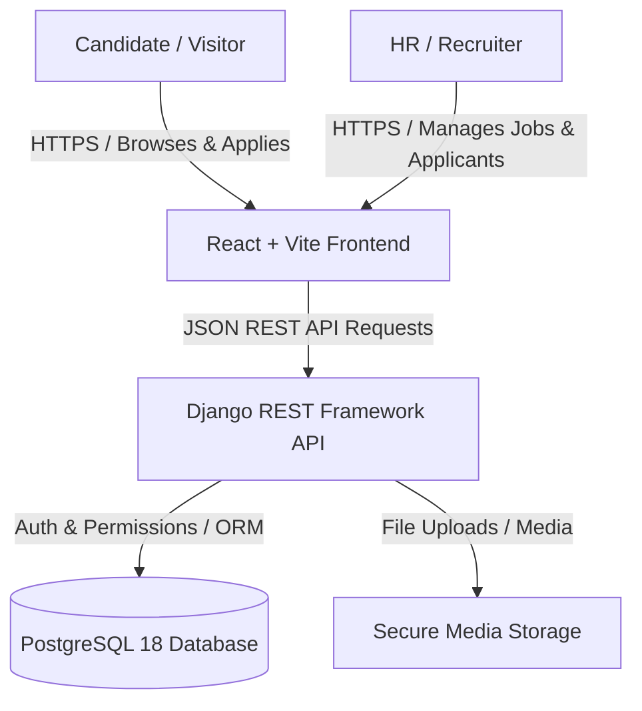

# Chakan Job Portal — Architecture & Technical Specification
**Document ID:** CHJ-ARCH-001  
**Version:** 1.0  
**Date:** 26 October 2026  
**Status:** Approved Phase 1 Specification  

---

## 1. Executive Summary & Architectural Overview

The Chakan Job Portal is being modernized from a legacy server-rendered Django application into a decoupled **React (Vite) Single Page Application** backed by a **Python / Django REST Framework (DRF)** API and a **PostgreSQL** database.



### Key Modernization Goals
1. **Security First:** Eliminate plaintext passwords in `HrUser`, migrate to Django's standard `AbstractUser` with secure PBKDF2/Argon2 hashing, and eliminate hardcoded database credentials using `.env`.
2. **Normalized PostgreSQL Schema:** Replace raw string list storage (e.g. `"['day', 'night']"`) with structured choices, integer ranges, and normalized relational models.
3. **Strict Multi-Tenant Isolation:** Object-level permission classes ensure recruiters can only access, modify, or delete their own job posts and view applicants for their own listings.
4. **Design System Fidelity:** Build the frontend with React + Vite following the approved design tokens (Ink `#0A0733`, Sage `#DDE5E0`, Warm Gold `#E0C75C`, Inter typography).

---

## 2. PostgreSQL Relational Data Model

### 2.1 User & Authentication Model (`accounts.User`)
Subclasses Django's `AbstractUser` to consolidate credentials, permissions, and recruiter profiles into a single secure table.

```python
# accounts/models.py
from django.contrib.auth.models import AbstractUser
from django.db import models

class User(AbstractUser):
    class Role(models.TextChoices):
        RECRUITER = 'RECRUITER', 'Recruiter'
        CANDIDATE = 'CANDIDATE', 'Candidate'
        ADMIN = 'ADMIN', 'Administrator'

    role = models.CharField(max_length=20, choices=Role.choices, default=Role.RECRUITER)
    mobile_number = models.CharField(max_length=15, unique=True)
    company_name = models.CharField(max_length=255, blank=True, default='')
    company_address = models.TextField(blank=True, default='')
    position = models.CharField(max_length=100, blank=True, default='')
    company_type = models.CharField(max_length=100, blank=True, default='')
    is_verified = models.BooleanField(default=False)
    created_at = models.DateTimeField(auto_now_add=True)
    updated_at = models.DateTimeField(auto_now=True)

    def __str__(self):
        return f"{self.username} ({self.get_role_display()} - {self.company_name})"
```

### 2.2 Job Post Model (`jobs.JobPost`)
Represents employer job openings in the Chakan industrial area.

```python
# jobs/models.py
from django.db import models
from django.conf import settings

class JobPost(models.Model):
    class JobType(models.TextChoices):
        INDUSTRY = 'INDUSTRY', 'Industry Job'
        OFFICE = 'OFFICE', 'Office Job'
        FIELD = 'FIELD', 'Field Job'
        WFH = 'WFH', 'Work From Home'

    class ShiftType(models.TextChoices):
        DAY = 'DAY', 'Day Shift'
        NIGHT = 'NIGHT', 'Night Shift'
        ROTATIONAL = 'ROTATIONAL', 'Rotational Shift'
        ANY = 'ANY', 'Any Shift'

    class EducationLevel(models.TextChoices):
        BELOW_10TH = 'BELOW_10TH', 'Below 10th'
        TENTH = '10TH', '10th Pass'
        TWELFTH = '12TH', '12th Pass'
        ITI = 'ITI', 'ITI'
        DIPLOMA = 'DIPLOMA', 'Diploma'
        GRADUATION = 'GRADUATION', 'Graduate / BE / B.Tech'
        POST_GRADUATION = 'POST_GRADUATION', 'Post Graduate'

    class ExperienceLevel(models.TextChoices):
        FRESHER = 'FRESHER', 'Fresher'
        ONE_TO_TWO = '1_2_YEARS', '1-2 Years'
        THREE_TO_FIVE = '3_5_YEARS', '3-5 Years'
        FIVE_TO_TEN = '5_10_YEARS', '5-10 Years'
        TEN_PLUS = '10_PLUS_YEARS', '10+ Years'

    class GenderPreference(models.TextChoices):
        MALE = 'MALE', 'Male'
        FEMALE = 'FEMALE', 'Female'
        ANY = 'ANY', 'Any Gender'

    class Status(models.TextChoices):
        ACTIVE = 'ACTIVE', 'Active'
        CLOSED = 'CLOSED', 'Closed'
        DRAFT = 'DRAFT', 'Draft'

    recruiter = models.ForeignKey(
        settings.AUTH_USER_MODEL,
        on_delete=models.CASCADE,
        related_name='job_posts'
    )
    title = models.CharField(max_length=255, db_index=True)
    description = models.TextField()
    openings = models.PositiveIntegerField(default=1)
    
    # Financials (integers for reliable numeric queries and sorting)
    min_salary = models.PositiveIntegerField(default=0)
    max_salary = models.PositiveIntegerField(default=0)
    charges_applicable = models.BooleanField(default=False)

    # Job Specifications
    job_type = models.CharField(max_length=50, choices=JobType.choices, default=JobType.INDUSTRY)
    shift = models.CharField(max_length=50, choices=ShiftType.choices, default=ShiftType.DAY)
    min_education = models.CharField(max_length=50, choices=EducationLevel.choices, default=EducationLevel.TENTH)
    course_required = models.CharField(max_length=255, blank=True, default='')
    experience_required = models.CharField(max_length=50, choices=ExperienceLevel.choices, default=ExperienceLevel.FRESHER)
    gender_preference = models.CharField(max_length=20, choices=GenderPreference.choices, default=GenderPreference.ANY)
    facilities = models.CharField(max_length=255, blank=True, default='Bus, Canteen')

    # Location & Area Focus
    area = models.CharField(max_length=255, default='Chakan MIDC', db_index=True)
    village = models.CharField(max_length=255, blank=True, default='')
    company_address = models.TextField(blank=True, default='')
    bus_route = models.TextField(blank=True, default='')

    # Recruiter Contact Preferences
    calling_number = models.CharField(max_length=20, blank=True, default='')
    whatsapp_number = models.CharField(max_length=20, blank=True, default='')
    email = models.EmailField(blank=True, default='')

    status = models.CharField(max_length=20, choices=Status.choices, default=Status.ACTIVE, db_index=True)
    created_at = models.DateTimeField(auto_now_add=True, db_index=True)
    updated_at = models.DateTimeField(auto_now=True)

    class Meta:
        ordering = ['-created_at']

    def __str__(self):
        return f"{self.title} at {self.recruiter.company_name} ({self.area})"
```

### 2.3 Candidate Application Model (`jobs.Application`)
Stores candidate job submissions.

```python
# jobs/models.py
class Application(models.Model):
    class Status(models.TextChoices):
        SUBMITTED = 'SUBMITTED', 'Submitted'
        SHORTLISTED = 'SHORTLISTED', 'Shortlisted'
        REVIEWING = 'REVIEWING', 'In Review'
        REJECTED = 'REJECTED', 'Rejected'
        HIRED = 'HIRED', 'Hired'

    job_post = models.ForeignKey(
        JobPost,
        on_delete=models.CASCADE,
        related_name='applications'
    )
    full_name = models.CharField(max_length=255)
    age = models.PositiveSmallIntegerField()
    qualification = models.CharField(max_length=100)
    course_name = models.CharField(max_length=255, blank=True, default='')
    mobile_number = models.CharField(max_length=15)
    current_address = models.TextField()
    resume_file = models.FileField(upload_to='resumes/%Y/%m/', null=True, blank=True)
    status = models.CharField(max_length=20, choices=Status.choices, default=Status.SUBMITTED)
    submitted_at = models.DateTimeField(auto_now_add=True)

    class Meta:
        ordering = ['-submitted_at']
        indexes = [
            models.Index(fields=['job_post', 'submitted_at']),
        ]

    def __str__(self):
        return f"{self.full_name} -> {self.job_post.title}"
```

---

## 3. Django REST Framework (DRF) API Contract

All endpoints follow standard HTTP verbs, provide ISO 8601 timestamps, and return JSON responses with standard error envelopes:
```json
{
  "success": false,
  "error": {
    "code": "VALIDATION_ERROR",
    "message": "Invalid input data",
    "details": { "mobile_number": ["Mobile number must be 10 digits."] }
  }
}
```

### 3.1 Public Candidate APIs
| Method | Endpoint | Description | Auth Required |
|---|---|---|---|
| `GET` | `/api/jobs/` | List and search public active jobs with pagination (`page`, `page_size`, `search`, `area`, `job_type`, `shift`, `education`, `experience`, `min_salary`). | Public |
| `GET` | `/api/jobs/{id}/` | Detailed job posting information with related jobs query. | Public |
| `POST` | `/api/jobs/{id}/apply/` | Submit a job application. Validates required fields, age constraints, mobile number format. | Public |
| `GET` | `/api/jobs/filters/` | Returns available filter choices (areas, shifts, qualifications) for dynamic UI dropdowns. | Public |

### 3.2 Authentication & Account APIs
| Method | Endpoint | Description | Auth Required |
|---|---|---|---|
| `POST` | `/api/auth/register/` | Register a new recruiter account. Hashes password securely. | Public |
| `POST` | `/api/auth/login/` | Recruiter login. Returns DRF Token or session cookie with recruiter details. | Public |
| `POST` | `/api/auth/logout/` | Invalidates token/session. | Recruiter |
| `GET` | `/api/auth/me/` | Retrieves authenticated recruiter profile. | Recruiter |
| `PUT/PATCH` | `/api/auth/me/` | Update company profile and contact details. | Recruiter |

### 3.3 Recruiter Management APIs
| Method | Endpoint | Description | Auth Required |
|---|---|---|---|
| `GET` | `/api/recruiter/jobs/` | List all job posts owned by the authenticated recruiter. | Recruiter (Owner) |
| `POST` | `/api/recruiter/jobs/` | Create a new job post under the authenticated recruiter's company. | Recruiter |
| `GET` | `/api/recruiter/jobs/{id}/` | Get recruiter's job post details with applicant count. | Recruiter (Owner) |
| `PUT/PATCH` | `/api/recruiter/jobs/{id}/` | Update recruiter's job post. | Recruiter (Owner) |
| `DELETE` | `/api/recruiter/jobs/{id}/` | Soft delete or delete recruiter's job post. | Recruiter (Owner) |
| `GET` | `/api/recruiter/jobs/{id}/applicants/` | List all candidate applications for this specific job. | Recruiter (Owner) |
| `PATCH` | `/api/recruiter/applications/{id}/status/` | Update candidate application status (Shortlist/Reject/Hired). | Recruiter (Owner) |
| `GET` | `/api/recruiter/dashboard/summary/` | Summary metrics (Active jobs count, total applications, recent applicants). | Recruiter |

---

## 4. Frontend Architecture (React + Vite)

### 4.1 Technology Stack
- **Build Tool:** Vite (fast ESM bundler)
- **UI Framework:** React 18+
- **Styling:** Vanilla CSS with CSS Variables mapped 1-to-1 to [`Chakan_Job_Portal_Design_Tokens (2).md`](file:///d:/ProjectFolder/Chakan_Jobs/docs/Chakan_Job_Portal_Design_Tokens%20%282%29.md)
- **Routing:** React Router DOM (v6/v7)
- **Icons:** Lucide React (clean, accessible vector icons)
- **HTTP Client:** Fetch / Axios with centralized error and auth interceptors

### 4.2 Page & Route Hierarchy
```
/                      -> Public Homepage (Hero, Search Bar, Featured Jobs, Area Highlights, Trust section)
/jobs                  -> Job Search & Listings (Filter drawer on mobile, sidebar on desktop, pagination)
/jobs/:id              -> Job Details Page (Company info, requirements, compensation, Apply panel)
/jobs/:id/apply        -> Candidate Application Form (Validation, progress state, success confirmation)
/recruiter/login       -> Recruiter Login Screen
/recruiter/signup      -> Recruiter Registration Screen
/recruiter/dashboard   -> Recruiter Management Dashboard (Stats, active listings table, actions)
/recruiter/jobs/new    -> Create Job Post Form (Multi-section: General, Specs, Compensation, Location)
/recruiter/jobs/:id/edit -> Edit Job Post Form
/recruiter/jobs/:id/applicants -> Applicant Review List (Table/Cards with contact actions)
```

### 4.3 Component Tree Architecture
```
src/
├── assets/             # Brand logos, illustrations
├── components/
│   ├── common/         # Button, Input, Select, Badge, Card, Modal, Spinner, EmptyState, ErrorBanner
│   ├── layout/         # Header, Footer, RecruiterNav, Container, MobileDrawer
│   ├── jobs/           # JobCard, JobFilters, JobSearchBar, JobMetaPills, RelatedJobsList
│   └── recruiter/      # MetricCard, JobsTable, ApplicantCard, StatusSelect
├── context/
│   └── AuthContext.jsx # Recruiter auth state, login/logout methods, token persistence
├── services/
│   ├── api.js          # Base axios/fetch client with baseUrl and error interceptors
│   ├── jobService.js   # Public job endpoints
│   └── recruiterService.js # HR dashboard endpoints
├── styles/
│   ├── tokens.css      # CSS variables for colors, typography, spacing, radius, shadows
│   ├── base.css        # Reset, typography, utility classes
│   └── components/     # Scoped component styles
├── pages/              # Route views
└── App.jsx             # Router and Providers
```

---

## 5. Security & Authorization Architecture

1. **Authentication Mode:** 
   - Token-based (`rest_framework.authtoken`) or Secure HttpOnly Cookies for API requests.
2. **Object-Level Permissions:**
   - Custom DRF permission `IsJobOwner`:
     ```python
     class IsJobOwner(permissions.BasePermission):
         def has_object_permission(self, request, view, obj):
             return obj.recruiter == request.user
     ```
3. **Password Security:**
   - Uses Django's `PBKDF2PasswordHasher` with 720,000 iterations. Plaintext passwords are completely eliminated.
4. **Environment Isolation:**
   - `python-dotenv` loads `.env` for `SECRET_KEY`, `DEBUG=False` in production, `DATABASE_URL`, and `ALLOWED_HOSTS`.
5. **CORS / CSRF Configuration:**
   - `django-cors-headers` configured strictly to allowed origins (`http://localhost:5173` in local dev).

---

## 6. Phase Acceptance Checklist

- [x] High-level architecture defined and verified with project constraints.
- [x] Normalized PostgreSQL schema designed (Users, JobPosts, Applications).
- [x] Complete DRF API endpoint contract and error specification documented.
- [x] React + Vite frontend page hierarchy and design token integration mapped.
- [x] Security, password hashing, and object-level authorization architecture defined.
- [x] Documented in [`docs/Chakan_Job_Portal_Architecture_Spec.md`](file:///d:/ProjectFolder/Chakan_Jobs/docs/Chakan_Job_Portal_Architecture_Spec.md).
